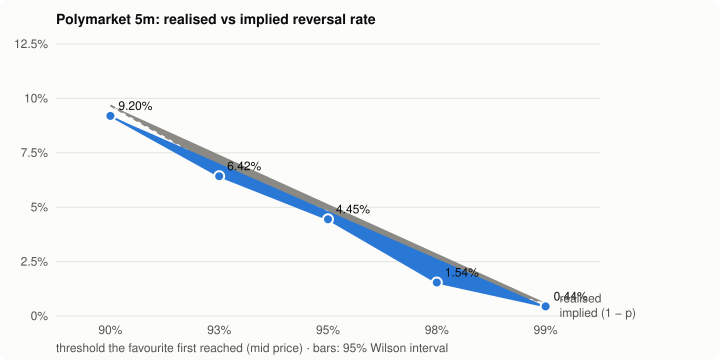
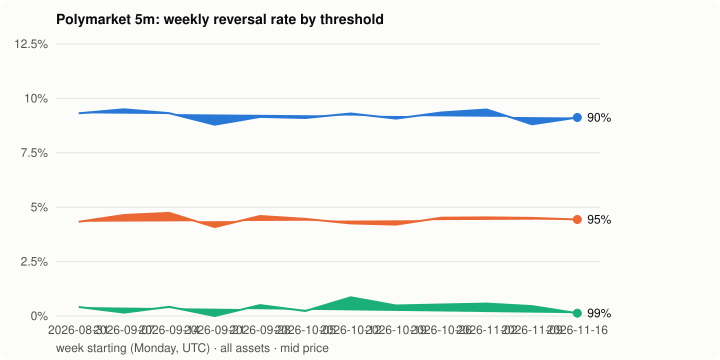

# Polymarket 5-minute Up/Down: how often does a 90–99% favourite lose?

[中文](README.zh-CN.md) · Data: [outcometick](https://outcometick.com?utm_source=github&utm_medium=readme&utm_campaign=reversal-stats) · Sister repo: [Predict.fun reversal stats](https://github.com/outcometick/predict-fun-reversal-stats)

In Polymarket's 5-minute crypto Up/Down markets, once one side's price first reaches 90%, 93%, 95%, 98% or 99%, how often does that side still lose at the close? This repository answers that from tick-level order-book data and **updates itself every day**.

**Coverage:** 2026-09-02 → 2026-11-24 (UTC), 84 days, 169,147 settled 5-minute markets across BTC, BNB, DOGE, ETH, HYPE, SOL, XRP. Last updated 2026-11-24.

## Headline — all assets, mid price

| favourite first reached | rounds that got there | favourite lost | reversal rate | 95% interval | avg price at trigger | win rate − price |
| --- | ---: | ---: | ---: | ---: | ---: | ---: |
| 90% | 167,279 | 15,320 | 9.16% | 9.02% – 9.30% | 0.9031 | 0.53 pp |
| 93% | 166,472 | 10,644 | 6.39% | 6.28% – 6.51% | 0.9318 | 0.42 pp |
| 95% | 164,828 | 7,305 | 4.43% | 4.33% – 4.53% | 0.9515 | 0.42 pp |
| 98% | 145,312 | 2,237 | 1.54% | 1.48% – 1.60% | 0.9808 | 0.38 pp |
| 99% | 16,528 | 67 | 0.41% | 0.32% – 0.51% | 0.9940 | 0.20 pp |



*Implied* is 1 − the average price paid at the trigger. When the realised rate sits above it, the favourite at that price lost more often than its price said; "win rate − price" is the same gap seen from the buyer's side, before fees.

## By asset — reversal rate at each threshold (mid)

| asset | 90% | 93% | 95% | 98% | 99% | rounds at 95% |
| --- | ---: | ---: | ---: | ---: | ---: | ---: |
| **all** | 9.16% | 6.39% | 4.43% | 1.54% | 0.41% | 164,828 |
| BTC | 8.33% | 5.82% | 4.07% | 1.40% | 0.46% | 23,999 |
| BNB | 9.59% | 6.69% | 4.71% | 1.55% | 0.45% | 23,837 |
| DOGE | 9.46% | 6.63% | 4.53% | 1.58% | 0.41% | 23,831 |
| ETH | 8.67% | 5.88% | 3.98% | 1.52% | 0.69% | 23,989 |
| HYPE | 9.17% | 6.48% | 4.66% | 1.57% | 0.17% | 21,225 |
| SOL | 9.43% | 6.42% | 4.46% | 1.57% | 0.50% | 23,976 |
| XRP | 9.47% | 6.83% | 4.65% | 1.61% | 0.25% | 23,971 |

## By price basis — all assets

| threshold | mid | best bid | trade |
| --- | ---: | ---: | ---: |
| 90% | 9.16% | 8.25% | 7.50% |
| 93% | 6.39% | 5.55% | 5.35% |
| 95% | 4.43% | 3.67% | 4.03% |
| 98% | 1.54% | 1.15% | 2.04% |
| 99% | 0.41% | 0.56% | 1.29% |

## Over time



## All the tables

- [`results/summary.csv`](results/summary.csv) — per asset × threshold: triggers, reversals, rate, 95% Wilson interval, average trigger price, win rate minus price
- [`results/by_price_basis.csv`](results/by_price_basis.csv) — the same, for each price basis
- [`results/daily.csv`](results/daily.csv) — per UTC day
- [`results/weekly.csv`](results/weekly.csv) — per week (Monday start, UTC)
- [`results/monthly.csv`](results/monthly.csv) — per month
- [`results/by_hour_utc.csv`](results/by_hour_utc.csv) — by the hour the market opened (UTC)
- [`results/by_seconds_to_close.csv`](results/by_seconds_to_close.csv) — by how many seconds before the close the threshold was first reached
- [`results/by_loser_peak.csv`](results/by_loser_peak.csv) — how high the losing side's mid price got before it lost
- [`results/data_quality.csv`](results/data_quality.csv) — per day and asset: rounds, settled, flat, unknown, rounds with no two-sided quote

Every table is computed from [`rounds/`](rounds/): one gzip CSV per UTC day, one row per market, with the outcome and — for each basis and threshold — which side got there first, when, and at what price. Use it to re-check a number or try your own thresholds.

## Definitions

- **Round**: one 5-minute market, assigned to the UTC day it opens.
- **Trigger**: the first moment inside the market's window when either side's price on the chosen basis is ≥ the threshold. That side is the favourite.
- **Reversal**: the favourite lost at settlement.
- Three price bases: **mid** = (best bid + best ask) / 2, **best bid**, and **trade** = the price of a print. Up and Down each have their own order book. Mid is counted only while both sides are quoted: a book with no ask is skipped rather than priced as 1.0. So a 99% mid needs an ask above 0.99, which only sub-cent ticks allow, and the 99% mid row has few rounds; for the 99% line read the best-bid basis.
- Only settled rounds count. Flat closes (rare) are left out.
- **Wilson interval**: 95% score interval on the reversal rate.
- **Win rate − price**: favourite win rate minus the average trigger price, in percentage points. Mid and best bid are not prices you can buy at (you pay the ask), and no fees are included — read it as a description of the market, not as a strategy result.

## Reproduce it

Code is in [`reversal_stats/`](reversal_stats/) (Python 3.10+, standard library only).

```bash
# one free sample day, no key
curl -L https://github.com/outcometick/polymarket-tick-data-samples/releases/latest/download/polymarket-data-samples.tar.gz | tar xz
python -m reversal_stats extract --venue polymarket --data ./polymarket-data-samples --day <sample day> --out my-rounds
python -m reversal_stats report --venue polymarket --rounds my-rounds --out my-report

# any range you have a data subscription for
pip install outcometick
export OT_KEY="ck_..."
python -m reversal_stats fetch --venue polymarket --from <first day> --to <last day> --data ./archive
python -m reversal_stats extract --venue polymarket --data ./archive --from <first day> --to <last day> --out my-rounds
```

Inputs per day: best_bid_ask (unthrottled top of book), last_trade_price and markets, as delivered by the [outcometick](https://outcometick.com?utm_source=github&utm_medium=readme&utm_campaign=reversal-stats) archive. The sample README names its day.

## Data and license

Market data: [outcometick](https://outcometick.com?utm_source=github&utm_medium=readme&utm_campaign=reversal-stats) — tick-level Polymarket and Predict.fun crypto Up/Down archives (order books, trades, settlement feeds), free sample days, and a hosted backtester. Results and rounds: CC BY 4.0, attribution "outcometick". Code: MIT.
