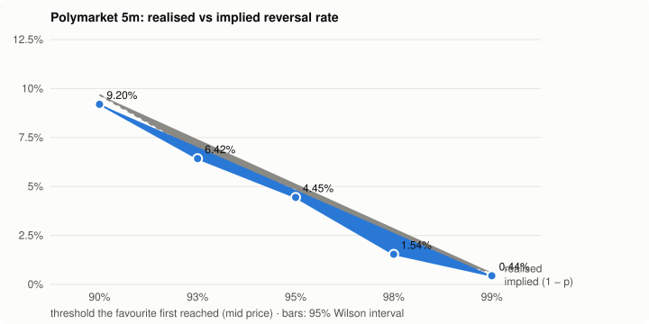
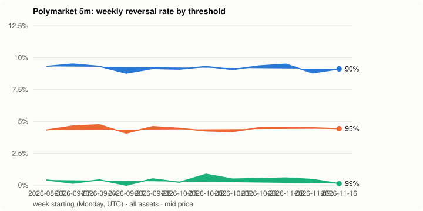

# Polymarket 5 分钟涨跌盘：概率到 90–99% 的一方有多大概率翻车？

[English](README.md) · 数据来源：[outcometick](https://outcometick.com/zh?utm_source=github&utm_medium=readme&utm_campaign=reversal-stats) · 姊妹仓库：[Predict.fun 反转统计](https://github.com/outcometick/predict-fun-reversal-stats)

Polymarket 的 5 分钟加密货币涨跌盘里，一方价格首次到 90%、93%、95%、98%、99% 之后，收盘时它仍然输掉的比例有多高？本仓库用逐笔盘口数据统计这个问题，**每天自动更新**。

**覆盖范围：** 2026-09-02 → 2026-11-23（UTC），共 83 天，BTC, BNB, DOGE, ETH, HYPE, SOL, XRP 合计 167,131 个已结算的 5 分钟市场。最近更新 2026-11-23。

## 总览：全币种，中价口径

| 领先方首次到达 | 到达的局数 | 领先方输掉 | 反转率 | 95% 区间 | 触发时平均价 | 胜率 − 价格 |
| --- | ---: | ---: | ---: | ---: | ---: | ---: |
| 90% | 165,300 | 15,111 | 9.14% | 9.00% – 9.28% | 0.9031 | 0.55 pp |
| 93% | 164,515 | 10,502 | 6.38% | 6.27% – 6.50% | 0.9318 | 0.43 pp |
| 95% | 162,911 | 7,208 | 4.42% | 4.33% – 4.53% | 0.9515 | 0.43 pp |
| 98% | 143,782 | 2,204 | 1.53% | 1.47% – 1.60% | 0.9808 | 0.38 pp |
| 99% | 16,274 | 67 | 0.41% | 0.32% – 0.52% | 0.9940 | 0.19 pp |



「隐含」= 1 − 触发时的平均价格。实际反转率高于它，说明这个价位的领先方输得比价格暗示的更多；「胜率 − 价格」是站在买方角度看的同一个差值，未计手续费。

## 分币种：各阈值反转率（中价）

| 币种 | 90% | 93% | 95% | 98% | 99% | 95% 触发局数 |
| --- | ---: | ---: | ---: | ---: | ---: | ---: |
| **合计** | 9.14% | 6.38% | 4.42% | 1.53% | 0.41% | 162,911 |
| BTC | 8.33% | 5.84% | 4.09% | 1.41% | 0.47% | 23,711 |
| BNB | 9.58% | 6.67% | 4.70% | 1.55% | 0.46% | 23,563 |
| DOGE | 9.45% | 6.62% | 4.53% | 1.58% | 0.42% | 23,548 |
| ETH | 8.64% | 5.87% | 3.96% | 1.50% | 0.69% | 23,701 |
| HYPE | 9.14% | 6.48% | 4.64% | 1.58% | 0.18% | 21,013 |
| SOL | 9.41% | 6.41% | 4.45% | 1.55% | 0.51% | 23,691 |
| XRP | 9.43% | 6.79% | 4.62% | 1.60% | 0.26% | 23,684 |

## 分价格口径：全币种

| 阈值 | 中价 | 买一 | 成交价 |
| --- | ---: | ---: | ---: |
| 90% | 9.14% | 8.24% | 7.49% |
| 93% | 6.38% | 5.54% | 5.35% |
| 95% | 4.42% | 3.67% | 4.03% |
| 98% | 1.53% | 1.14% | 2.03% |
| 99% | 0.41% | 0.56% | 1.29% |

## 随时间变化



## 全部表格

- [`results/summary.csv`](results/summary.csv) — 每个币种 × 阈值：触发数、反转数、反转率、95% Wilson 区间、首次触发平均价、胜率减价格
- [`results/by_price_basis.csv`](results/by_price_basis.csv) — 同上，按价格口径拆开
- [`results/daily.csv`](results/daily.csv) — 按 UTC 日
- [`results/weekly.csv`](results/weekly.csv) — 按周（周一起，UTC）
- [`results/monthly.csv`](results/monthly.csv) — 按月
- [`results/by_hour_utc.csv`](results/by_hour_utc.csv) — 按开盘的 UTC 小时
- [`results/by_seconds_to_close.csv`](results/by_seconds_to_close.csv) — 按首次到达阈值时距收盘的秒数
- [`results/by_loser_peak.csv`](results/by_loser_peak.csv) — 输掉的一方在输之前中价最高到过多少
- [`results/data_quality.csv`](results/data_quality.csv) — 每天每币种：局数、已结算、平局、结果未知、没有双边报价的局数

所有表都由 [`rounds/`](rounds/) 算出：每个 UTC 日一个 gzip CSV，一行一个市场，记录结算结果，以及每种口径、每个阈值下哪一方先到、何时到、价格多少。可以用来核对数字，或换自己的阈值重算。

## 口径

- **局**：一个 5 分钟市场，按开盘时刻归入 UTC 日。
- **触发**：市场窗口内，任一方在所选口径下价格 ≥ 阈值的第一个时刻；这一方即「领先方」。
- **反转**：领先方在结算时输掉。
- 三种价格口径：**中价** =（买一 + 卖一）/ 2、**买一**、**成交价**。Up 和 Down 各有自己的盘口。中价只在买卖两边都有报价时计算：没有卖单的盘口直接跳过，不按 1.0 算。所以中价到 99% 要求卖一高于 0.99，只有不足一美分的小档位才会出现，99% 中价那一行局数很少；看 99% 请用买一口径。
- 只统计已结算的局。极少数平局不计入。
- **Wilson 区间**：反转率的 95% 置信区间。
- **胜率 − 价格**：领先方胜率减去首次触发平均价，单位百分点。中价和买一都不是你能买到的价格（买入付卖一），也没扣手续费，这是对市场的描述，不是策略收益。

## 自己复现

代码在 [`reversal_stats/`](reversal_stats/)（Python 3.10+，只用标准库）。

```bash
# 免费样本日，不需要 key
curl -L https://github.com/outcometick/polymarket-tick-data-samples/releases/latest/download/polymarket-data-samples.tar.gz | tar xz
python -m reversal_stats extract --venue polymarket --data ./polymarket-data-samples --day <样本日> --out my-rounds
python -m reversal_stats report --venue polymarket --rounds my-rounds --out my-report

# 订阅覆盖的任意日期范围
pip install outcometick
export OT_KEY="ck_..."
python -m reversal_stats fetch --venue polymarket --from <起始日> --to <结束日> --data ./archive
python -m reversal_stats extract --venue polymarket --data ./archive --from <起始日> --to <结束日> --out my-rounds
```

每天用到的数据：best_bid_ask（未抽稀的盘口顶部）、last_trade_price、markets，来自 [outcometick](https://outcometick.com/zh?utm_source=github&utm_medium=readme&utm_campaign=reversal-stats) 归档。样本日见样本仓库 README。

## 数据与许可

市场数据：[outcometick](https://outcometick.com/zh?utm_source=github&utm_medium=readme&utm_campaign=reversal-stats) —— Polymarket 与 Predict.fun 加密涨跌盘逐笔归档（盘口、成交、结算价流），提供免费样本日和托管回测。统计结果与 rounds：CC BY 4.0，署名「outcometick」。代码：MIT。
